## 🔢 Steps

1. Source all the parts from the shopping list
1. Print the parts
1. Prepare the power supply and solder the wiring harness
1. Flash the ESP with the software and verify that all sensors work (connect it to your Home Assistant instance to monitor them).
1. Assemble the sensors, ESP and power supply into the insert.
1. Have the insert connected to mains and mounted in the wall box.
1. After a few minutes, calibrate the sensors.
1. Create your Home Assistant automations using the sensors.

### 🛒 Shopping List

You can buy the parts wherever you like. I only linked parts where the exact version matters.

| Name | Hint | Link |
| ----- | ------ | ------ |
| Deep wall box | See "What it fits" above, e.g. Kaiser 9064-01. | |
| ESP32-C6 Super Mini | Other Super Mini boards (e.g. ESP32-C3 or ESP32-S3) have the same size and fit into the insert as well, but the firmware and the wiring tables are made for the ESP32-C6. With another board you have to adapt the board and the pins in `device.yaml` yourself, and OpenThread only works with the C6. | [Aliexpress](https://de.aliexpress.com/item/1005009089500839.html) (you need to choose the correct version manually) |
| Power Supply Mean Well IRM-10-5 | 5 V / 2 A module for mains, sits in its own capsule at the back of the wall box. | |
| Temperature Sensor SHT41 | Small breakout board with 2 mounting holes. | |
| Motion Sensor Panasonic EKMC1603111 | Small PIR with a Ø20.5 mm lens that looks through the cover plate. Much more reliable than the HC-SR501. | |
| Capacitors for the PIR | 1× 100 nF and 1× 100 µF, soldered next to the PIR. | [Amazon](https://www.amazon.de/dp/B0DXC7MX53) |
| Brightness Sensor BH1750 | Works flawlessly for me, no hints necessary. | |
| Presence Sensor LD2410B | I recommend buying the sensor with pins and also buy the appropriate cable with it. Soldering these small pins is extremely hard and can even damage the sensor. Therefore I recommend attaching the cable using the plug and soldering only the side that must be attached to the ESP. | [Aliexpress](https://de.aliexpress.com/item/1005004920357733.html) |
| LED | One segment of a WS2812B 5V RGB LED strip (10 mm wide). If you are like me you may have them already lying around at home 😄. | |
| Cables | 22 AWG silicone wire for the low-voltage side, mains-rated wire and connectors for the power supply input, heat shrink tubing | |
| Cable Distribution (Proto Boards) | Two small pieces of proto board distribute 5 V, 3.3 V, GND and I2C. | |
| Screws | <ul><li>6x M1.7x6mm: presence sensor bracket, PIR clamp ring, power supply capsule (2 each)</li><li>6x M2x3mm: SHT41 (1), BH1750 (2), front to carrier (3)</li></ul> | |
| Frame | Busch-balance® SI frame (e.g. 1721-914) or the printed frame | |
| Filament | PETG in white, a little transparent PETG for the light window. | |

You also need:

- A soldering iron (and soldering skills)
- Solder
- Wire stripping tool
- Side cutters to trim the cables
- Screwdriver
- Pliers
- Heat gun or lighter for the heat shrink tubing
- Multimeter (optional if you trust your soldering skills)

### 🖨️ Printed Parts

| Part | Picture | Orientation | Hint |
| --- | --- | --- | --- |
| 1 Front | 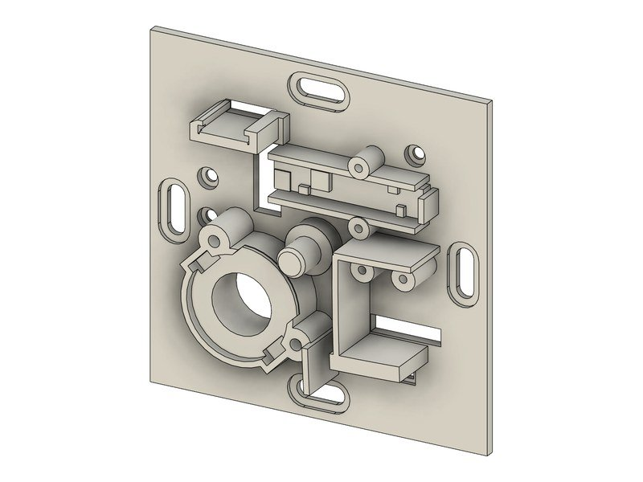 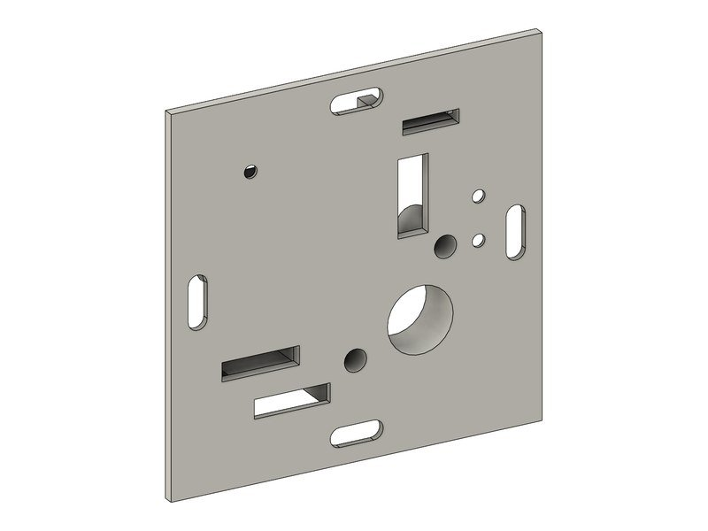 | Back of the flange on the build plate | Holds all sensors. The pin in the middle holds the cover plate; use the modifier for it (more walls, 100 % infill). |
| 2 Carrier with divider wall | 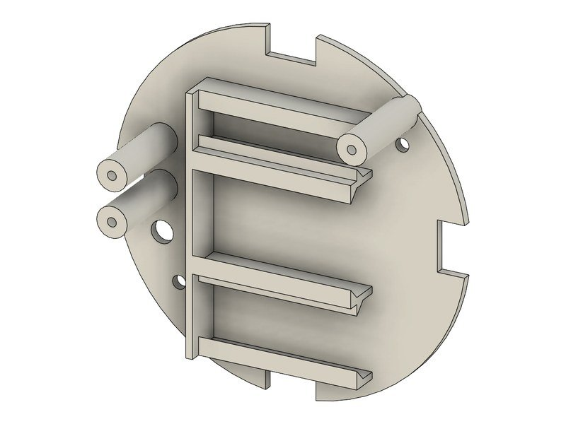 | Divider wall on the build plate | Holds the ESP and the two distribution boards in its chambers. The divider wall separates the mains side (back) from the low-voltage side (front). |
| 3 Power supply capsule | 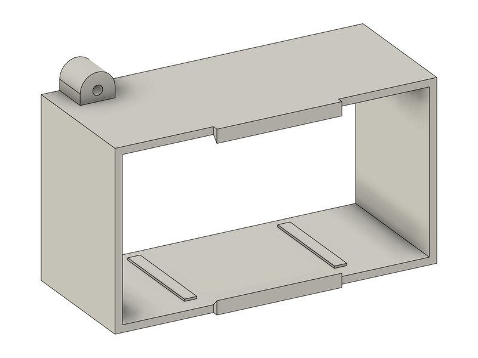 | Divider side on the build plate | Encloses the mains power supply, screwed to the back of part 2. |
| 6 Presence sensor bracket | 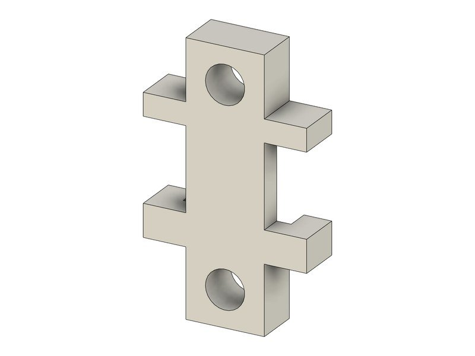 | Flat | Holds the LD2410B. |
| 7 PIR clamp ring | 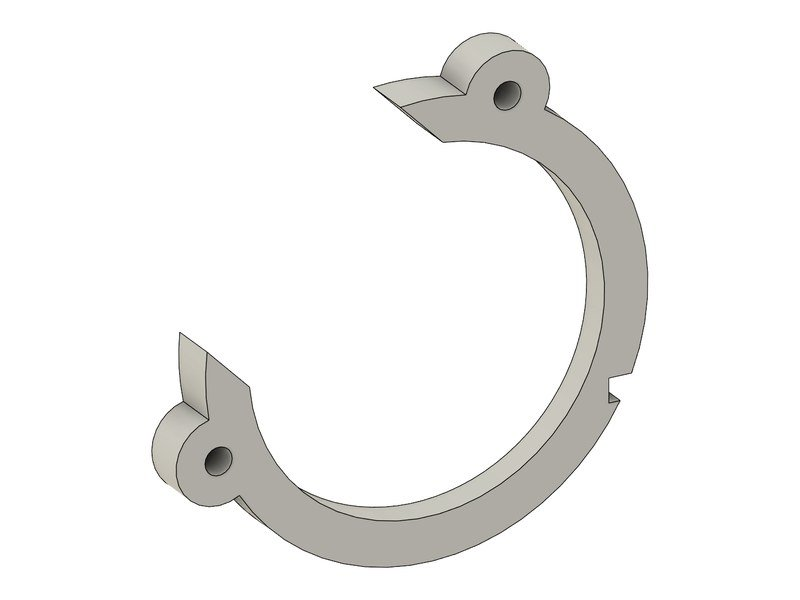 | Flat | Holds the PIR in its socket from the back. |
| 8 Cover plate | 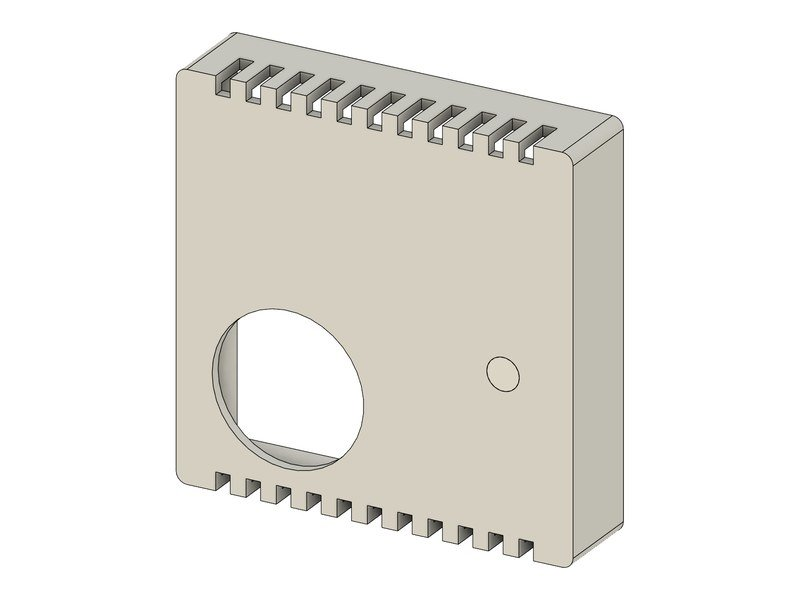 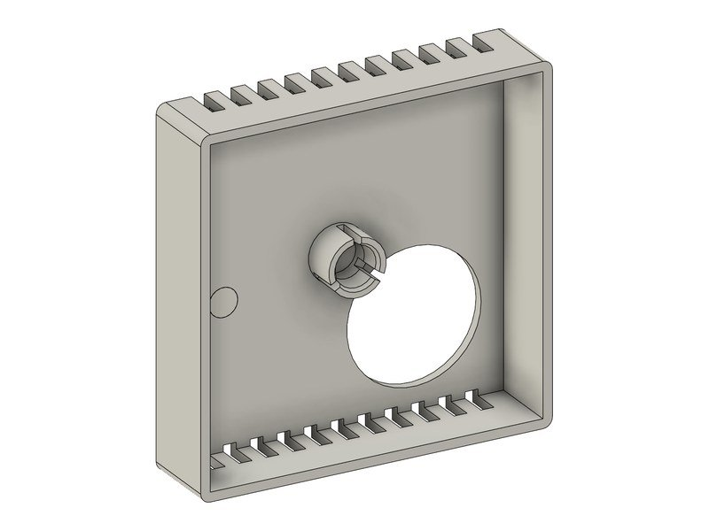 | Front on the build plate | Printed together with part 9. The slotted sleeve on the back clamps onto the pin of part 1. |
| 9 Light window |  | In the hole of part 8 | Transparent filament, multi-color print with part 8. |
| 10 SHT plug | 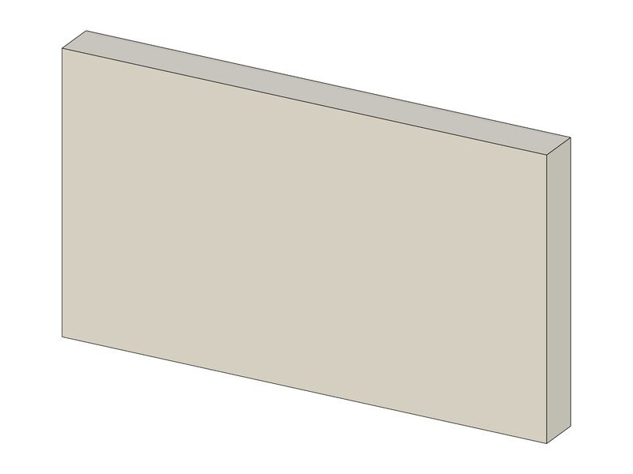 | Collar on the build plate | Closes the slot of the temperature sensor in the flange so no warm air rises from the wall box. Its left side is open for the wires. |
| 11 Frame (optional) | 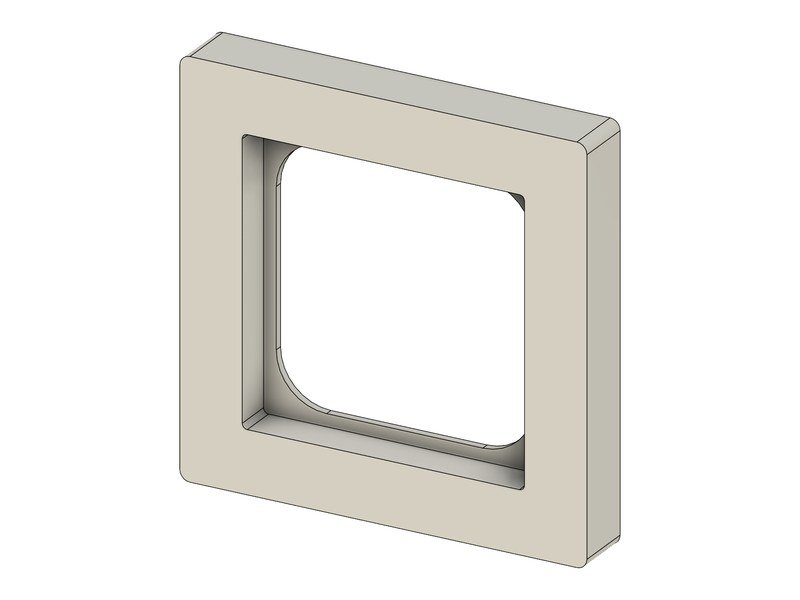 | Front on the build plate | Only if you don’t use an original frame. future® linear needs supports. |
| 4 Light plug (optional) | 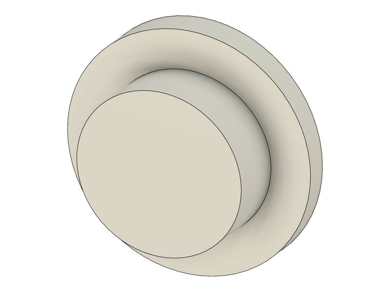 | Collar on the build plate | Only with an original Busch-Jaeger cover plate, transparent. |
| 5 Drilling template (optional) | 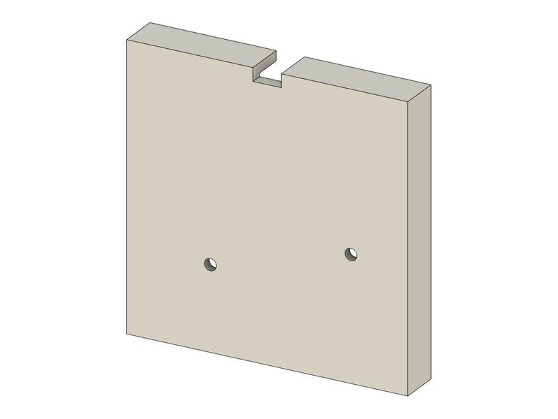 | Flat | Only to drill an original Busch-Jaeger cover plate. |

This is how the sensors sit on part 1 and the ESP and the power supply on part 2:

| Part 1 with sensors | Part 2 with ESP | Part 2 with power supply (back) |
| --- | --- | --- |
| 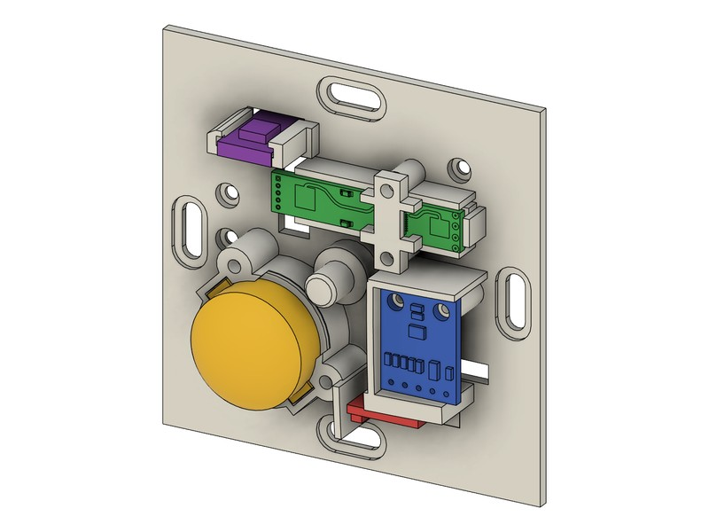 | 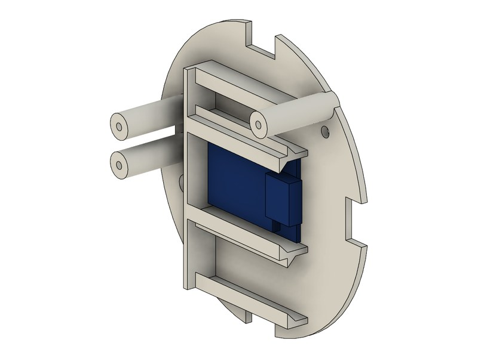 | 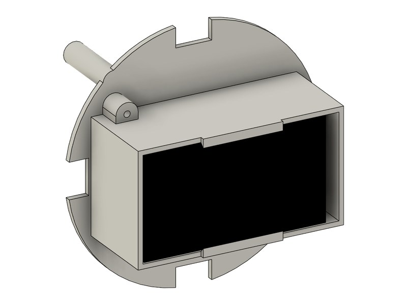 |

#### Other frames and cover plates

The frame and the cover plate are parametric in the Fusion 360 file on MakerWorld. Open **Modify → Change Parameters** and set the size of your switch range, then export the components *Rahmen (parametrisch)* and *Zentralscheibe (parametrisch)*. The comments of each parameter list the values for Busch-balance® SI and future® linear.

| Parameter | Meaning |
| --- | --- |
| `rahmen_breite`, `rahmen_hoehe`, `rahmen_tiefe` | Outer size and height of the frame |
| `rahmen_ecke_aussen`, `rahmen_ecke_innen` | Fillet of the outer corners and of the corners of the opening (0 = sharp) |
| `scheibe_breite`, `scheibe_hoehe`, `scheibe_ecke` | Size and corner fillet of the cover plate |
| `scheibe_luft` | Gap between cover plate and frame on each side |
| `lippe_breite`, `lippe_hoehe`, `lippe_ecke` | Opening of the inner lip of the frame (not smaller than 51 mm) |
| `rahmen_lippe_dicke` | Thickness of the inner lip |
| `dosenrand` | Height of the rim of your wall box above the wall |

#### Using an original Busch-Jaeger cover plate

1. Put the drilling template (part 5) over the cover plate, the notch marks the top.
1. Pre-drill the two holes with Ø2.5 mm.
1. Drill the PIR hole to **Ø21 mm** and the light hole to **Ø4.5 mm**.
1. Push the light plug (part 4) into the small hole from the back.

### ⚡ Wiring

I only had a limited number of different colored cables. I used the following colors:

- red = 3.3V (SHT41/BH1750/PIR)
- white = 5V (power supply/LD2410B/LED)
- black = Ground
- blue = I2C SDA / LD2410B TX
- green = I2C SCL / LD2410B RX
- yellow = Motion Out
- orange = LED data

Make sure you don't mix 5V and 3.3V.

#### Pins

| Function | ESP32-C6 Super Mini |
| --- | --- |
| PIR Out | GPIO7 |
| I2C SDA (SHT41, BH1750) | GPIO20 |
| I2C SCL (SHT41, BH1750) | GPIO19 |
| ESP TX → LD2410B RX | GPIO17 |
| LD2410B TX → ESP RX | GPIO16 |
| Status LED data input | GPIO18 |

The ESP32-C6 Super Mini has only one GND pin, so the GND rows of the two distribution boards are connected with a bridge wire.

#### Wiring diagram

The distribution boards are drawn as rails: all holes of a row are connected. The exact hole of each wire is in the tables below.

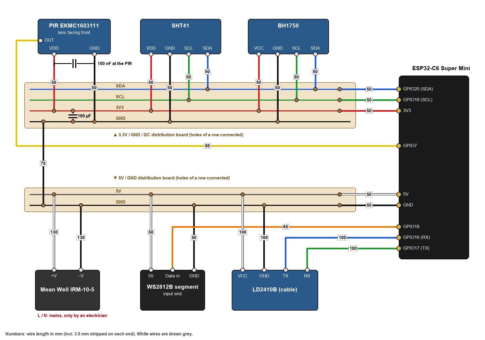

#### Distribution boards

Each cell is one hole, the holes of a row are connected. When you cut the proto board, cut through the next row of holes so the edge holes stay intact.

**5V/GND board** 2 × 5 holes:

| Row | 1 | 2 | 3 | 4 | 5 |
| --- | --- | --- | --- | --- | --- |
| 5V (white) | Power supply +V | LED 5V | LD2410B VCC | – | ESP 5V |
| GND (black) | Power supply −V | LED GND | LD2410B GND | Bridge to 3.3V board | ESP GND |

**3.3V/GND/I2C board** 4 × 5 holes:

| Row | 1 | 2 | 3 | 4 | 5 |
| --- | --- | --- | --- | --- | --- |
| SDA (blue) | – | – | SHT41 SDA | BH1750 SDA | ESP GPIO20 |
| SCL (green) | – | – | SHT41 SCL | BH1750 SCL | ESP GPIO19 |
| 3V3 (red) | PIR VDD | 100 µF + | SHT41 VDD | BH1750 VCC | ESP 3V3 |
| GND (black) | PIR GND | 100 µF − | SHT41 GND | BH1750 GND | Bridge from 5V board |

The 100 nF capacitor goes directly across VDD and GND of the PIR, the 100 µF capacitor next to the PIR on the distribution board. PIR Out, LD2410B TX/RX and the LED data input go directly to the ESP.

#### Wire lengths

These are the lengths I cut (in mm, including 3.5 mm stripped on each end). The ESP sits with its components facing front and USB-C to the right.

| Connection | Color | Length |
| --- | --- | --- |
| Power supply +V → 5V board | white | 130 |
| Power supply −V → 5V board GND | black | 130 |
| ESP 5V → 5V board | white | 50 |
| ESP GND → 5V board | black | 50 |
| ESP 3V3 → 3.3V board | red | 50 |
| ESP GPIO20 SDA → 3.3V board | blue | 50 |
| ESP GPIO19 SCL → 3.3V board | green | 50 |
| GND bridge 5V board → 3.3V board | black | 75 |
| PIR VDD → 3.3V board | red | 50 |
| PIR GND → 3.3V board | black | 50 |
| PIR OUT → ESP GPIO7 | yellow | 50 |
| SHT41 (4 wires) → 3.3V board | red/black/blue/green | 50 |
| BH1750 (4 wires) → 3.3V board | red/black/blue/green | 50 |
| LD2410B VCC/GND → 5V board (cable from the plug) | white/black | 100 |
| LD2410B TX → ESP GPIO16 | blue | 100 |
| LD2410B RX → ESP GPIO17 | green | 100 |
| LED 5V/GND → 5V board | white/black | 50 |
| LED data input → ESP GPIO18 | orange | 65 |

### 🔢 Assembly Instructions

I built it from the back to the front: first the power supply on part 2, then the wiring harness, and part 1 with the sensors at the very end. The PIR is soldered to its wires last: it has to be pushed into part 1 from the front and screwed in first, because the lens does not fit through the PIR socket.

1. Cut all wires to length (see the table above) and tin the wire ends.
1. **Power supply:** solder the mains wires to the AC pins of the IRM-10-5 and insulate them with heat shrink. Solder the white and black 5V wires to +V and −V.
1. Slide the power supply from the front into the **capsule (part 3)**. Thread the 5V wires from the back through the small opening in the divider wall of **part 2**, then screw the capsule to the divider wall (2x M1.7x6mm from the front).

    | Power supply in the capsule | 5V wires through the divider wall |
    | --- | --- |
    | 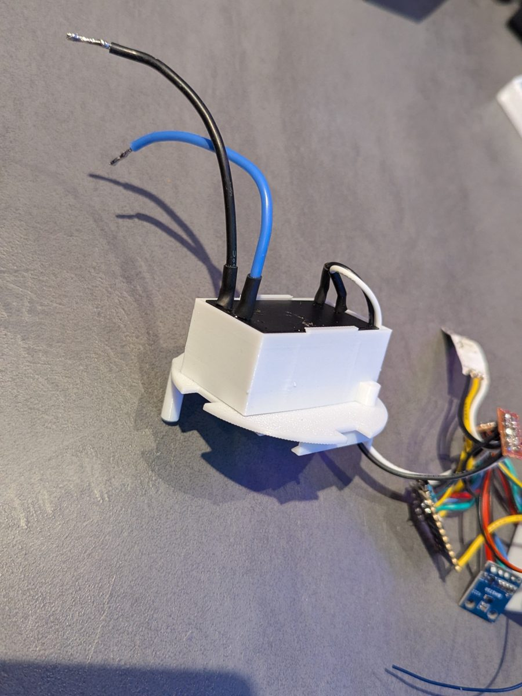 | 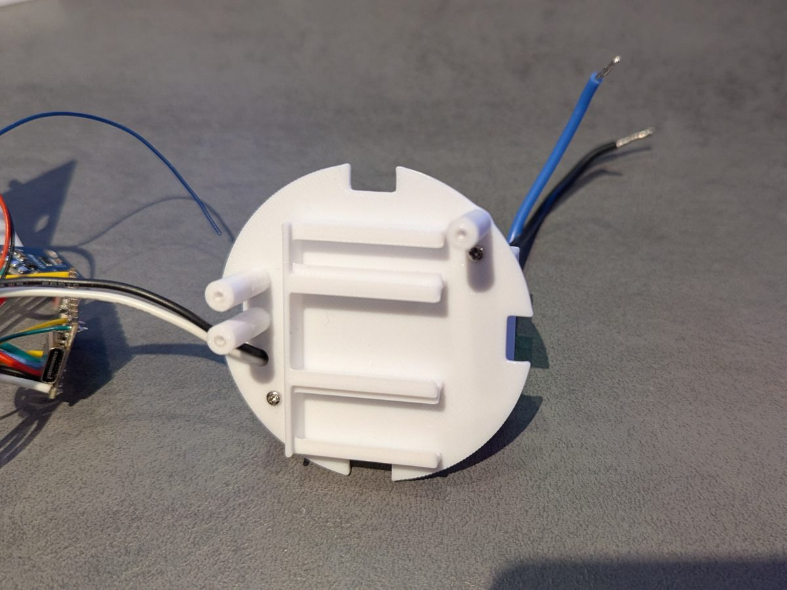 |

1. Solder **one end** of the wires to the **temperature sensor**, the **brightness sensor**, the **presence sensor cable** and the input end of the **LED segment**.

    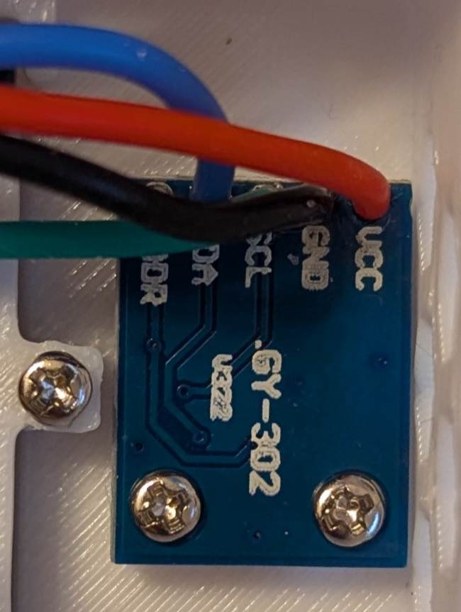

1. Solder the **other ends** to the **distribution boards** and the **ESP** according to the wiring diagram and the tables above, together with the 100 µF capacitor (+ to 3V3). Solder the three **PIR wires** only to the 3.3V board and GPIO7 for now, their other end stays free.
1. **Prepare the PIR:** solder the 100 nF capacitor directly to VDD and GND of the PIR.
1. Solder the 5V wires of the **power supply** to the 5V board.
1. Use a **multimeter** to verify that solder joints of different colors do not bridge. Any short can damage components and may cause smoke or even fire.
1. Slide the ESP (components facing front, USB-C to the right) and both distribution boards from the right into the chambers of part 2.

    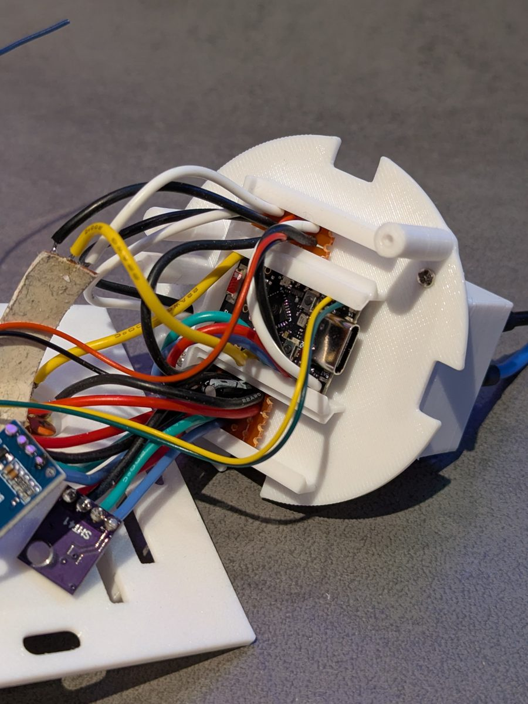

1. **PIR:** push the PIR from the front into its socket in **part 1** so the two lugs sit in their pockets and screw the **clamp ring (part 7)** with 2x M1.7x6mm from the back. Only then solder the free ends of the PIR wires to VDD, GND and OUT on the back of the PIR and check these joints with the multimeter as well.
1. Now it's time to check whether all the soldering has worked out. Power the ESP via USB-C, flash the software (see the software section), verify that all sensors are detected and reporting, then return here to complete assembly. **Never connect USB and mains at the same time.**
1. Hold part 1 about 4–5 cm in front of part 2, push the other sensors and the LED from the back through their openings in part 1 and fasten them:
    - **Presence sensor:** lay the LD2410B into its seat, the plug end goes through the opening in the flange. Screw the **bracket (part 6)** over it with 2x M1.7x6mm.
    - **Brightness sensor:** screw the BH1750 onto its domes (2x M2x3mm).
    - **Temperature sensor:** push the board against the back wall of its chamber, press the **SHT plug (part 10)** into the slot next to the wires (its left side is open for them), then screw the SHT41 (1x M2x3mm).
    - **LED:** slide the LED segment into the grooves of its holder and bend the short end over the posts.

    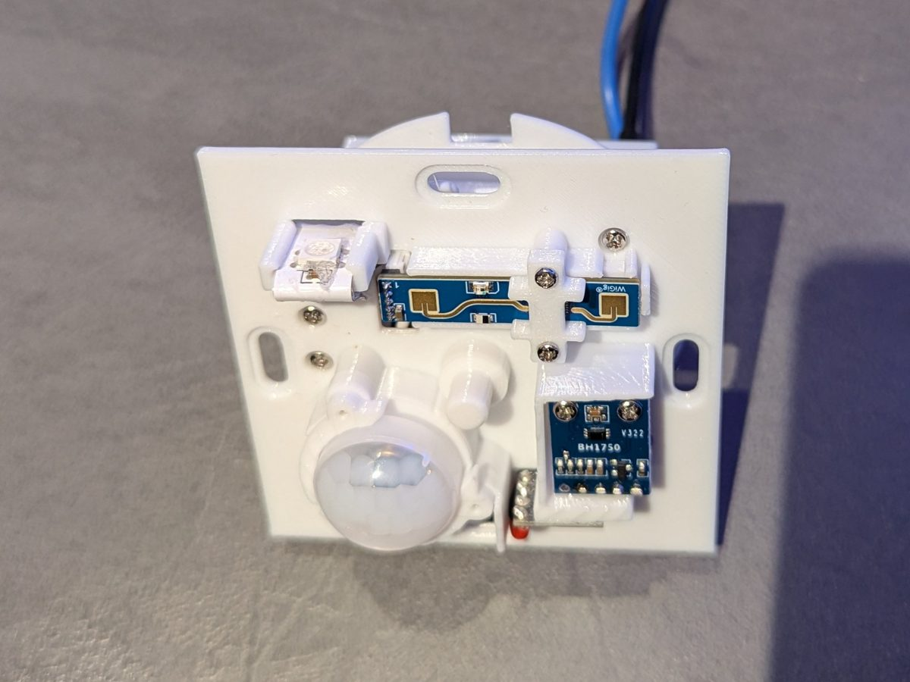

1. Screw part 1 to part 2 (3x M2x3mm).

    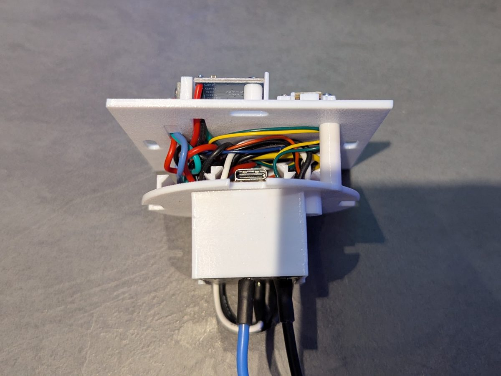

1. **Mounting (electrician):** switch off the circuit and verify it is dead. Connect L and N of the power supply to the mains cable with suitable connectors, insulate PE and bend it away. Push the insert into the wall box and fasten it with the device screws through the slots of the flange (both orientations work).

    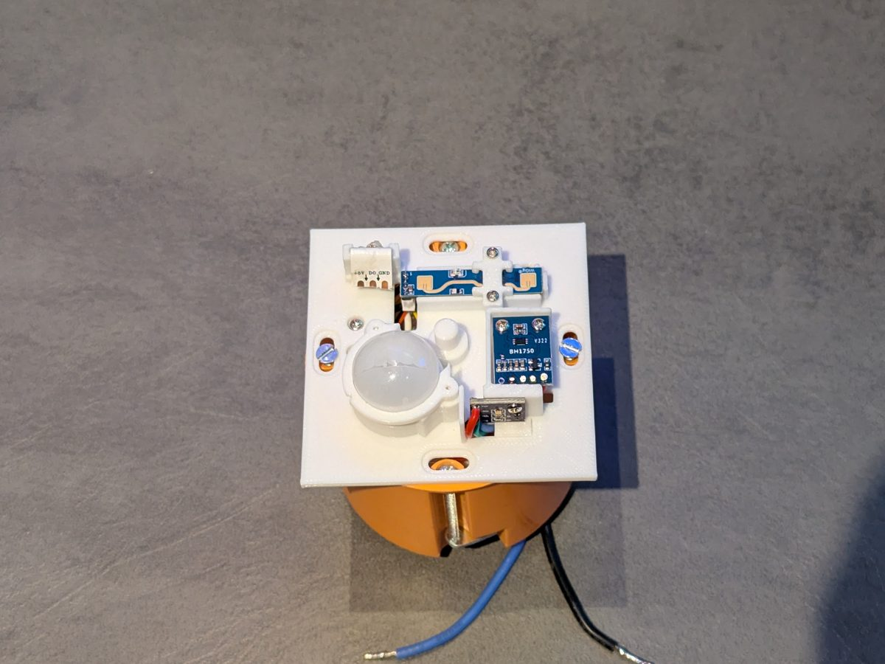

1. Put the frame on and push the cover plate onto the pin in the middle until it sits on the frame. It holds the frame in place.

    | Frame and cover plate | Installed |
    | --- | --- |
    | 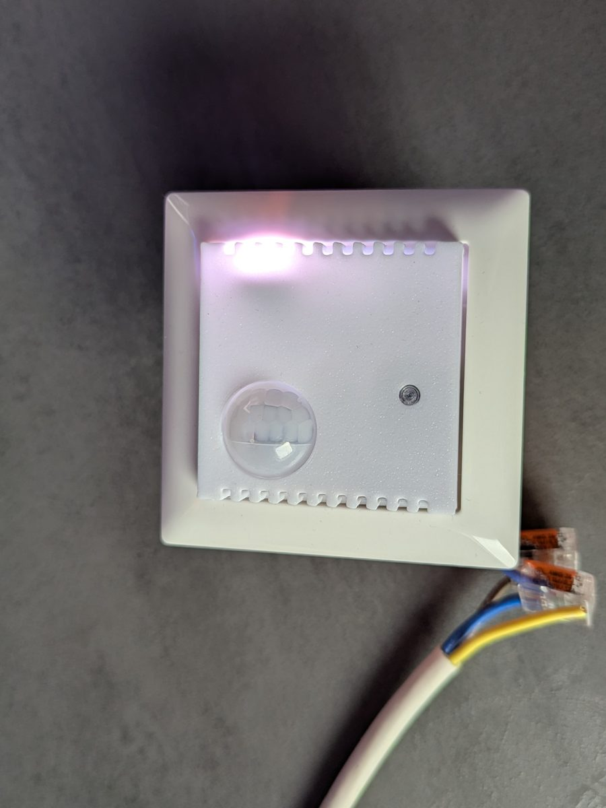 | 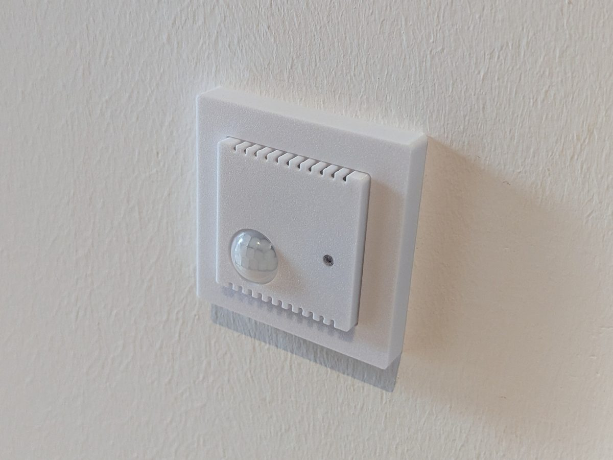 |

**Congratulations — you’re done!** 🥳🎉

Post a picture and a comment to this model — I’d love to see your results 🤗

### 💾 Software

This project uses [ESPHome](https://esphome.io/) as the underlying software. It’s easy to set up and flash. It uses YAML files that define the sensors connected to the device and their properties. You can either checkout my code and compile it yourself or you can pick one of my precompiled firmware binaries and flash it. I won’t provide general ESPHome compilation instructions — the official documentation is excellent:
Guide: <https://esphome.io/guides/installing_esphome/>

#### Flash my precompiled binaries

##### Initial installation

1. Navigate to [my Github](https://github.com/DerGary/all-in-one-sensor-device/releases?q=flush-mount&expanded=true) and find the latest Release.
1. In the assets section find the binary for your language (`de`/`en`). Pick the `factory` version for initial setup.
1. Navigate to [web.esphome.io](https://web.esphome.io/).
1. Connect the esp to your computer.
1. Click connect and choose the Serial Port (probably there is only one).
1. Click install, choose the `factory` binary file that you downloaded earlier
1. Click install and wait.
1. The LED will flash green after a successful install.
1. Open the Home Assistant app on your smartphone. Make sure that Bluetooth is turned on.
1. Open the ``integration and devices`` view. Home Assistant should pick up the sensor and you can click add.
1. Define WiFi Credentials and click ok.
1. After that you can add the ESPHome integration. Check your router for the ip address of the sensor.
1. Once deployed in its final location, proceed with calibration.

##### Update

1. Navigate to [my Github](https://github.com/DerGary/all-in-one-sensor-device/releases?q=flush-mount&expanded=true) and find the latest Release.
1. In the assets section find the binary for your language (`de`/`en`). Pick the ``ota`` version to update an existing sensor.
1. Navigate to the web page of the sensor by typing its IP address in your browser.
1. At the bottom of the page you will find the OTA update section.
1. Choose the previously downloaded file and click update.

#### Flash code directly

1. Install esphome
1. Checkout my [Github Repository](https://github.com/DerGary/all-in-one-sensor-device)
1. Navigate into the FlushMount folder in a terminal
1. execute `esphome -s lang de run device.yaml`
    - For ``lang`` you can choose between ``de`` and ``en``
1. After flashing proceed with adding the sensor to your home assistant instance as described in [initial installation](#initial-installation) section above.

#### OpenThread (instead of WiFi)

As an alternative to WiFi, the device can connect via **OpenThread** — useful if you already run a Thread border router (e.g. via Home Assistant's OTBR add-on) and want to keep the sensor off your WiFi network. The ESP32-C6 has the 802.15.4 radio that Thread needs.

> **⚠️ There are no precompiled OpenThread binaries.** A Thread network's credentials (the "dataset") must be compiled directly into the firmware — unlike WiFi, there is no equivalent of Improv BLE to provide them after flashing. This means every Thread-connected device needs its own custom build with its own dataset baked in.

To build and flash with OpenThread:

1. Get your Thread dataset TLV from Home Assistant: **Settings → Devices & Services → Thread** integration → **Configure** → select your preferred network → click the info (ⓘ) icon → copy the **Dataset TLVs** value.
1. Install esphome and checkout the [Github Repository](https://github.com/DerGary/all-in-one-sensor-device) as described in [Flash code directly](#flash-code-directly) above.
1. Navigate into the `FlushMount` folder in a terminal.
1. execute `esphome -s lang <lang> -s connectivity thread -s openthread_tlv <your-tlv> run device.yaml`
    - For ``lang`` you can choose between ``de`` and ``en``
    - Replace `<your-tlv>` with the dataset TLV from step 1.
1. Once flashed, the device joins your Thread network directly — no WiFi pairing step is needed.

Switching back to WiFi later requires reflashing with `-s connectivity wifi_improv` (the default).

#### Status LED

The LED sits behind the upper edge of the cover plate and shines through the ventilation slots.

| Color | Pattern | Meaning |
| --- | --- | --- |
| Green | Fast Pulse | Sensor is waiting to be paired via Improv BLE |
| Pink | Fast Pulse | Sensor is not connected to wifi or home assistant |
| Warm White | Steady | When the occupancy automation is enabled, indicates that the area is occupied. |
| Turquoise | Slow Pulse | When the high humidity automation is enabled, indicates that humidity is above the configurable threshold (default 65 %). |

### 🎯 Calibration

Calibration is **non-trivial** and may take time and multiple iterations. I mainly use **offset calibration**, which is the easiest approach, though there are more accurate methods also available.

#### SHT41

1. Let the device sit in the wall for at least **30 minutes** so the wall box reaches its normal temperature.
1. Place a **trusted temperature & humidity sensor** nearby.
1. Calibrate humidity and temperature using the input components **Temperature Offset** and **Humidity Offset** directly in Home Assistant.

#### Motion Sensor

The Panasonic EKMC has no potentiometers. The firmware keeps the motion state on for 5 seconds after the last detection, the presence sensor takes over after that.

#### Presence Sensor

This sensor is the most challenging to calibrate. The g0-g8 values depict the different distances from the sensor.

1. **Enable Engineering Mode**
1. Ensure **no one is in the room** while calibrating.
1. Let the sensor sit for **10 minutes** while Home Assistant gathers **g0–g8 move/still** energy values.
1. Review the history of each **g0–g8** value in Home Assistant. Find the **highest** value each.
1. Set the **g0–g8 still thresholds** to **10 % higher** than the highest observed value for this distance.
1. Set the **g0–g8 move thresholds** to **20 % higher** than the highest observed value for this distance.
1. **Disable engineering mode**

### 🚫 Don'ts

1. Don’t place the wall box **too high**. Hot air rises and will skew temperature readings; it may also affect the motion sensor.
1. Don’t place it **near a heater** — it reduces temperature accuracy and can trigger the motion sensor.
1. Don’t place it directly in strong airflow (e.g., when airing the room), as the motion sensor detects rapid heat changes.

### 📢 Tips

- It’s preferable to place the wall box **facing the area where you stay** rather than just facing the door. The motion sensor has a wide field of view and covers most of the room, while the presence sensor works best when pointed directly at the target.
- You can test all sensors with **jumper wires** before committing to soldering.
