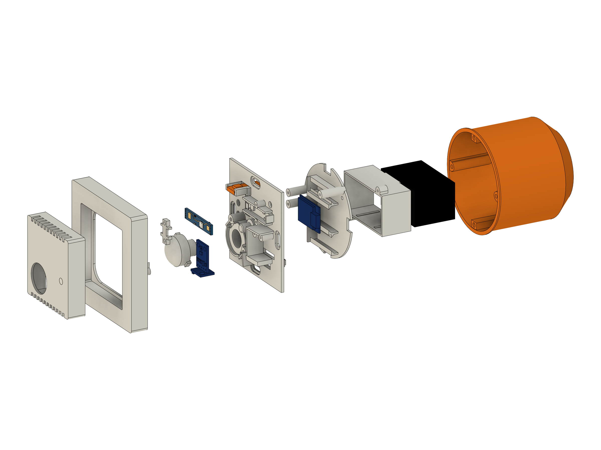

# All-In-One Smart Home Sensor – Flush-Mount

[Makerworld](https://makerworld.com/de/models/3630191-all-in-one-smart-home-sensor-flush-mount#profileId-4162540)

## 🆕 Also check out the Ultimate Version

This flush-mount version uses the sensor set of the budget-friendly V2.1. For rooms where you need more — multi-target tracking, zone tracking, reliable presence detection for very still people (e.g. watching TV or sleeping), more accurate temperature & humidity, more sophisticated air quality measurements, or a more reliable PIR sensor — check out the [Ultimate Smart Home Sensor Case](https://makerworld.com/de/models/2946707-ultimate-smart-home-sensor-case). It comes at a higher component cost, but offers significantly more capability where it counts.

## Please read the disclaimer at the bottom before building

> **⚠️ This device is connected to 230 V mains.** The power supply sits inside the wall box. Connecting it to mains must only be done by a qualified electrician. Mistakes can kill you or start a fire.

Hello everyone 👋, this is the flush-mount version of my [All-In-One Smart Home Sensor Case V2.1](https://makerworld.com/de/models/2180710-all-in-one-smart-home-sensor-case-v2#profileId-2381634). It contains almost the same set of sensors (only air quality is missing), but instead of sitting on a shelf with a USB cable, it disappears into a deep hollow-wall box behind a normal switch frame. If you have any questions about the project please ask them in the comments then I can answer them and everyone can learn from that.

When I started building my smart home, I realized that most devices only cover very specific use cases. To get full functionality in each room, you usually need to buy multiple different devices.

My goal with this project was to create **the ultimate DIY smart home sensor device** that integrates all the essential sensors needed to achieve the following:

## 🎯 Goals

1. Control the lighting in a room by turning it on when motion is detected and keeping it on as long as someone is present (even if the person is not moving).
1. Monitor the brightness in the room and only turn lights on if needed (and off again when no longer required).
1. Measure humidity and temperature.
1. Use Bluetooth to track a person’s smartphone and thereby determine which room they are in, so the smart home can react accordingly.
1. Fit completely into a wall box, flush with the wall like a light switch.
1. No visible cable: powered from mains inside the wall box.
1. Blend in with the switches next to it: it uses a standard switch frame and a cover plate in the same size as a central plate of the switch range.
1. Integrate with Home Assistant.
1. No cloud dependency.

## 🧱 What it fits

- **Wall box:** a deep round wall box for Ø68 mm holes with 60 mm device screw spacing. The insert reaches about **47 mm behind the wall**: the box needs a free Ø47 mm down to that depth and about Ø63 mm in the first 17 mm (besides the screw domes). The rim of the box should not stand out more than 1 mm from the wall. I use a Kaiser 9064-01 (Ø68 × 61 mm), which fits. The insert works in both orientations (device screws left/right or top/bottom).
- **Frame:** Busch-Jaeger Busch-balance® SI (e.g. 1721-914), or the printed frame. A printed frame for Busch-Jaeger future® linear is included as well.
- **Cover plate:** printed cover plate (55 × 55 mm for Busch-balance® SI, 63 × 63 mm for future® linear), or an original Busch-Jaeger central plate 2114-914 that you drill with the included drilling template.

Busch-Jaeger, Busch-balance and future are trademarks of Busch-Jaeger Elektro GmbH. They are only named to describe compatibility; this project is not affiliated with them.

## 🖨️ Print Instructions

- **Material:** PETG (it gets warm inside the wall box next to the power supply)
- **Settings:** standard profile, 0.20 mm layer height, 0.4 mm nozzle
- **Part 1 (front):** the pin in the middle that holds the cover plate is printed with 100 % infill using the modifier included in the print file, otherwise it can break off.
- **Cover plate:** print the light window in transparent filament in the same print (multi-color).
- **Frames:** print front side down. Both frames need supports from the build plate under their inner lip. If your printer prints outer dimensions too small, use X-Y contour compensation **only for the frames** — never for the cover plate, its clamping sleeve would get too tight and break.
